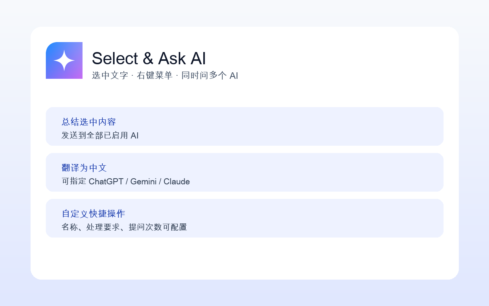

# Select & Ask AI

[](./LICENSE)
[](./src/manifest.config.js)
[](https://github.com/baozheliu/select-and-ask-ai/actions/workflows/ci.yml)

选中网页文字，通过右键菜单把「处理要求 + 选中内容」一键发送到一个或多个 AI 网页版。基于 **Manifest V3**、[Vite](https://vitejs.dev/)、[Vue 3](https://vuejs.org/) 和 [`@crxjs/vite-plugin`](https://crxjs.dev/vite-plugin)。



## 支持的 AI

ChatGPT、Gemini、Claude、Grok、DeepSeek、豆包、Kimi。

使用你已有的网页版登录状态，不需要 API Key，扩展不保存任何 AI 账号密码。

## 功能

- **快捷操作**：自定义操作名称与处理要求，支持创建、编辑、复制、删除、启停和排序，修改后立即同步右键菜单。内置「总结选中内容」「翻译为中文」两个可修改的示例。
- **多 AI 并发提问**：每个快捷操作可发送给全部已启用 AI 或单独指定；每个 AI 可独立提问 1～5 次（提供“一问三连”快捷选项），每次提问都是独立的新对话。
- **固定的标签页行为**：始终在当前窗口后台打开新标签页，不新建窗口、不覆盖当前网页；可选把同一次提问的标签页归为一组（默认关闭）。
- **执行状态提示**：在原网页显示轻量进度提示；单个任务失败不影响其他任务；发送失败时保留完整问题并自动复制到剪贴板作为兜底。
- **隐私**：所有配置保存在本地；默认不持久化选中内容（进行中的任务只放在会话级存储）；日志不包含提问内容。

## 快速开始

要求 Node.js 18+、npm 9+。

```bash
npm install
npm run build        # 或 npm run dev
```

在 Chrome / Edge 扩展管理页打开「开发者模式」，以「加载已解压的扩展程序」方式加载 `dist/` 目录。

其他命令：

```bash
npm run build:chrome     # 指定目标浏览器
npm run build:edge
npm run validate:manifest
npm run check            # 校验 manifest + 生产构建
```

## 使用方法

1. 首次安装会自动打开设置页，启用一个或多个 AI 并确保已在对应网站登录。
2. 在任意网页选中文字，右键选择 **Select & Ask AI** 下的快捷操作。
3. 扩展在当前窗口后台打开对应数量的标签页，自动填入并发送问题；你可以继续停留在原网页，通过右下角提示查看进度。

标签页总数 = 目标 AI 数量 × 每个 AI 的提问次数。超过 10 个标签页时首次执行会请你确认。

## 项目结构

```text
select-and-ask-ai/
├── public/
│   ├── _locales/                 # i18n 文案
│   └── assets/                   # 图标
├── src/
│   ├── background/               # MV3 service worker 入口
│   ├── content/                  # AI 站点内容脚本
│   │   ├── adapters/             # 每个 AI 一个独立适配器
│   │   └── dom.js                # 填入 / 发送 / 等待等通用 DOM 工具
│   ├── extension/                # 扩展基础设施
│   │   ├── background/
│   │   │   ├── context-menus.js  # 右键菜单同步
│   │   │   ├── task-runner.js    # 标签页任务调度与状态汇总
│   │   │   └── page-feedback.js  # 原网页提示 / 确认 / 剪贴板兜底注入
│   │   ├── browser/              # chrome.* Promise 封装
│   │   └── messaging.js          # 消息协议
│   ├── pages/                    # popup / options（Vue 3）
│   ├── shared/                   # 纯函数与数据模型
│   │   ├── providers.js          # AI 提供方注册表
│   │   ├── quick-actions.js      # 快捷操作模型与任务计划计算
│   │   └── prompt.js             # 发送内容组装
│   └── manifest.config.js
├── scripts/validate-manifest.mjs
└── docs/architecture.md
```

## 权限说明

| 权限 | 用途 |
|------|------|
| `contextMenus` | 右键菜单入口 |
| `storage` | 本地保存快捷操作与设置；会话区保存进行中的任务 |
| `activeTab` + `scripting` | 用户发起右键操作后，读取选中内容并在原网页显示状态提示 |
| `tabGroups` | 可选的标签页分组设置（仅 Chromium） |
| 内容脚本 host | 仅注入 7 个 AI 官方站点，用于填入与发送问题 |

详细的数据处理与删除说明见[隐私政策](./docs/privacy-policy.md)和[英文隐私政策](./docs/privacy-policy.en.md)。

## 适配新的 AI

1. 在 `src/shared/providers.js` 注册 id、名称、新对话地址与站点匹配规则。
2. 在 `src/content/adapters/` 新建适配器，配置输入框、发送按钮选择器与登录判定，并在 `adapters/index.js` 登记。

## Contributing

欢迎贡献。请先阅读 [CONTRIBUTING.md](./CONTRIBUTING.md) 与 [CODE_OF_CONDUCT.md](./CODE_OF_CONDUCT.md)。

安全相关问题请按 [SECURITY.md](./SECURITY.md) 私下报告。

## 第三方服务与商标

本项目不是任何受支持 AI 服务的官方产品，也不受其赞助或认可。相关名称和商标归各自权利人所有。使用本扩展前，请确认你的自动化使用方式符合目标网站的服务条款、账号政策和所在地法律。

## License

[MIT](./LICENSE) © baozheliu
